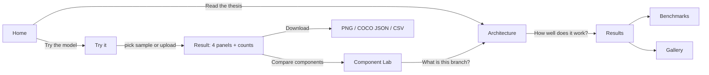
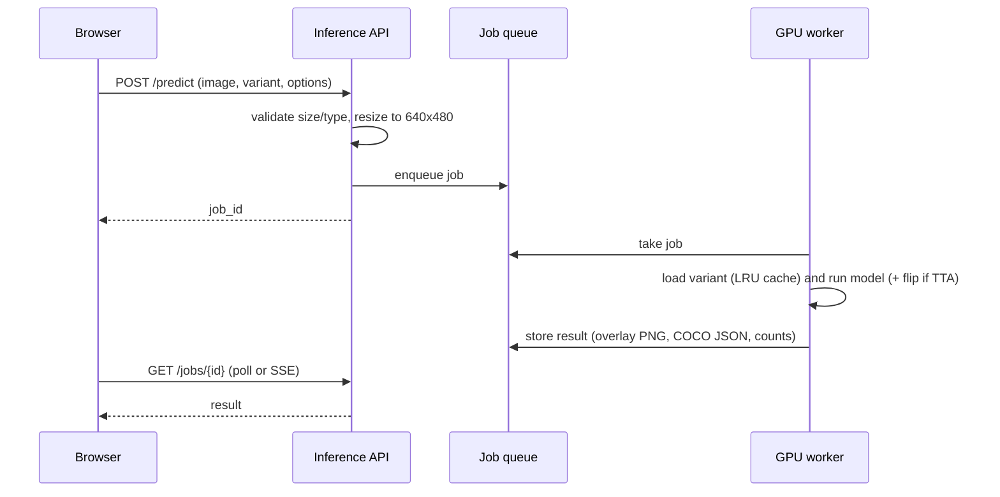
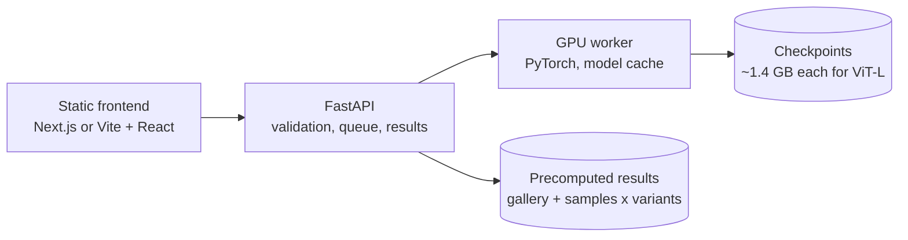

# SeaBed Lens (SeaBed-Net website) — features, pages and flow (draft, 2026-10-27)

**Status:** planning draft. Nothing is built. **Name: SeaBed Lens. Stack: Next.js + FastAPI (user, 2026-10-27).** Agent handoff: `WEBSITE_HANDOFF_SEABED_LENS.md`.

**Purpose:** a public companion site for the thesis. It has three jobs:

1. **Let people run the model** on a JODD image or their own underwater image, and see the detection and instance
   masks.
2. **Let people see what each component does** by running the same image through the full model and its ablated
   variants (CNN-only, ViT-only, no colour stems, ...).
3. **Present the thesis**: architecture, results on JODD, the ablations, and the RUOD / UIIS10K benchmarks.

---

## 1. Audiences, and what each needs

| Audience | Comes for | Must leave with |
|---|---|---|
| Thesis panel / adviser | Checking the claims | Every number traceable to a run; the ablations shown honestly, nulls included |
| Marine scientists / ROV operators | "Does it work on my footage?" | Upload → masks + counts per class, downloadable |
| CV / ML readers | Architecture and benchmarks | Diagram, the component ablation table, SOTA comparison, code / paper links |
| General public | A quick look | A gallery of before/after images that needs no explanation |

---

## 2. Pages

| # | Page | Main content |
|---|---|---|
| 1 | **Home** | One-line pitch, a hero before/after image, three headline numbers (JODD test bbox / mask AP, RUOD vs SOTA), buttons to **Try the model** and **Read the thesis** |
| 2 | **Try it** (demo) | Upload or pick a sample → run → 4-panel result. Runtime options (§3.2) |
| 3 | **Component Lab** | The same image through 2–4 model variants side by side, with each variant's measured AP beside it (§3.3) |
| 4 | **Architecture** | Interactive pipeline diagram: RGB → colour stems at C2 → ConvNeXt-T ‖ DINOv2 ViT-L → convex late fusion → FPN → TOOD (detection) ‖ SOLOv2 (masks). Click a block for its role, its paper, and the ablation that tests it |
| 5 | **Results** | JODD test results (n=3, mean ± sd), AP_S / AP_M / AP_L, per-class AP, the comparison tables (one per config change), model progression C2F_MDUAL → C2F_VITB_CVXMOS → VITL_ACC |
| 6 | **Benchmarks** | RUOD (UDINO and EDB-Net protocols) and UIIS10K vs published SOTA, with parameter counts and the protocol differences stated |
| 7 | **Dataset** | JODD-Seg: 20 classes, examples per class, instance counts, review coverage, how the masks were made (SAM + 3 human reviewers) |
| 8 | **Gallery** | Curated test images with best / typical / failure cases, filterable by class. Failures included on purpose |
| 9 | **About** | Thesis abstract, authors, adviser, PDF, citation (BibTeX), code link, acknowledgements (JAMSTEC J-EDI, DINOv2, ...) |

**MVP:** 1, 2, 3, 5, 9. The rest can follow.

---

## 3. Major features

### 3.1 Inference ("Try it")

- **Input:** upload JPG/PNG (≤ 10 MB), or pick one of ~30 curated JODD test images. A short video clip is a later
  extension (frame-by-frame, see §8).
- **Output, 4 panels**, matching the qualitative figures `eval_test_verified.py` already draws:
  RGB | ground truth (sample images only) | prediction (TOOD boxes + labels) | predicted instances (SOLOv2 masks,
  numbered per class: `starfish#1`, `starfish#2`, ...).
- **Below the image:** per-class counts, a table of instances (class, score, box, mask area), and inference time.
- **Downloads:** the overlay PNG, COCO-format JSON (boxes + RLE masks), and CSV counts.
- **Box and mask counts can differ.** The heads are decoupled (a panel requirement), so detection and segmentation
  each make their own predictions. The page should say this in one line, otherwise it reads as a bug.

### 3.2 Runtime options (no retraining, apply to any variant)

| Option | Default | Note |
|---|---|---|
| Score threshold | 0.3 | Slider 0.05–0.9; the figure threshold, not the 0.05 eval threshold |
| Show | boxes + masks | boxes only / masks only / both |
| Class filter | all 20 | Multi-select |
| Flip TTA | off | Two forward passes. Labelled "test-time augmentation"; changes results slightly and doubles the time |
| Mask opacity | 0.5 | Display only |

### 3.3 Component Lab: choosing CNN-only, ViT-only, ...

**The key design rule: each variant is its own trained checkpoint.** Switching off a branch inside the trained B0
model at inference time is not the same as an ablation. The other parts were trained to rely on it, so the output
collapses for reasons unrelated to the branch's value. F80 measured exactly this (the γ→0 test is an upper bound on
dependence, not the branch's value). The Lab therefore loads a different checkpoint per option, and every option shows
its own measured AP from the ablation runs.

Variants to offer, mapped to the thesis components:

| Variant | What is removed / changed | Component it tests | Config | Checkpoint |
|---|---|---|---|---|
| **Full model (B0)** | nothing | all | VITL_ACC | ✅ `ab_vitl_acc_s3.pth` |
| **ViT-only** | ConvNeXt branch + fusion removed | 2 (hybrid backbone) | `backbone_mode="vit_only"` | ⏳ to train (ablation program) |
| **CNN-only** | DINOv2 branch + fusion removed | 2 (hybrid backbone) | `backbone_mode="cnn_only"` | ⏳ to train |
| **No colour stems** | C2 colour stems removed, plain RGB ConvNeXt | 1 (colour processing) | `cnn_branch_spaces=()` | ⏳ to train |
| **RGB-only stems** | stems all RGB (capacity kept, colour removed) | 1 (colour processing) | `cnn_branch_spaces=("rgb","rgb","rgb")` | ⏳ to train |
| **Gated fusion** | convex gate → gated fusion | 2 (fusion design) | `marketnet_fuse="gated"` | ⏳ to train |
| **Smaller ViT (ViT-B)** | DINOv2 ViT-L → ViT-B | backbone scale | VITB_ACC | ✅ `ab_vitb_acc_s3.pth` |
| **Earlier models** | C2F_MDUAL, C2F_VITB_CVXMOS, frozen F75 | model history | — | ✅ exist |

Notes:

- **Component 3 (DAPFT) is dropped**, so it gets no toggle. The Results page explains why, with the evidence
  (F29 / F33 / F116 / F121).
- **Recipe-only ablations** (mosaic off, SimpleAug off) change training, not the model. They belong in Results, not
  the Lab, because a reader cannot "see" them in one image.
- The ⏳ checkpoints come from the ablation program proposed for B0. The website should not get its own runs. If a
  variant is not trained yet, show it greyed out with "pending ablation".
- **Lab layout:** pick 2–4 variants → the same image runs through each → one row per variant, with its test bbox /
  mask AP (n=3 where available) beside it, plus a "difference" view highlighting instances one variant found and
  another missed.

### 3.4 Results and transparency

- Every number on the site links to the run that produced it (run name, date, n, val/test). That is what the panel
  will check.
- Tables are generated from the same JSON files the repo already uses (`*.test_eval_verified.json`, histories), not
  typed by hand. A build script exports them to `site_data.json`.
- Nulls are shown as nulls ("no detectable difference"), with the 0.03 n=1 threshold explained once.
- TTA numbers always appear in a separate, labelled column.

---

## 4. User flows

### 4.1 Main flow

### 4.2 Inference request

### 4.3 Component Lab

Pick image → tick variants (greyed if not trained) → one job per variant → rows fill in as each finishes →
"difference" toggle → each row links to the variant's results.

---

## 5. Architecture and hosting

| Piece | Proposal | Why |
|---|---|---|
| Frontend | Next.js (or Vite + React), static export | Pages are mostly static; the demo is client-side calls to the API |
| API | FastAPI | Same language as the model code; simple async endpoints |
| Worker | One PyTorch process, bf16, batch 1, LRU cache of 2–3 variants | B0 is 352 M params (1.4 GB checkpoint, fp32); bf16 already used in training |
| Queue | In-process queue to start; Redis only if needed | Low traffic expected |
| Precompute | All sample + gallery images × all variants × TTA on/off, stored as static files | Most visitors only click samples; this needs no GPU at view time |

**Speed:** on the 4070 Ti, test evaluation ran 2,440 images in 215 s, so about 0.1 s per image including scoring.
On CPU expect several seconds per image for ViT-L. Measure both before promising a number on the page.

**The GPU is the hard constraint.** The training card is shared with the experiment queue (`queue_runner.py`), and a
live demo on it would compete with ablation runs. Options, best first:

1. **Precompute + small live demo:** samples, gallery and Lab use precomputed outputs. Live upload runs only on B0 and
   only when the card is free, or on CPU with a "may take ~10 s" notice.
2. **Separate GPU host** for the defence period (e.g. a paid GPU Space or a cloud instance).
3. **CPU only**, ViT-B variant for uploads. Slower and not the headline model; least preferred.

---

## 6. API sketch

| Method | Path | Does |
|---|---|---|
| GET | `/variants` | List of variants: name, component, trained?, test AP, checkpoint id |
| GET | `/samples` | Curated images with ground truth available |
| POST | `/predict` | Image + variant + options → `job_id` |
| GET | `/jobs/{id}` | Status, then overlay URLs, COCO JSON, counts, timing |
| POST | `/compare` | Image + list of variants → one job per variant |
| GET | `/results/{table}` | Pre-built results tables from `site_data.json` |

---

## 7. Things to settle before building

1. **Image licence.** JODD comes from JAMSTEC J-EDI. Check whether showing the images publicly (gallery, samples) is
   allowed, and the required credit line. This decides whether samples can ship at all.
2. **Uploads and privacy.** Delete uploads after N hours, and state it. No accounts.
3. **Which ablation checkpoints exist in time.** The Lab is only as complete as the ablation program. Decide the order
   of ablation runs with the website in mind (ViT-only and CNN-only first make the best demo).
4. **Hosting during the defence.** Option 1 vs 2 in §5, and who pays.
5. **Where the code lives.** A separate `website/` folder with its own README, so it never touches the notebooks or
   patch scripts.
6. **Model loading code.** Reuse `eval_test_verified.py`'s rebuild (saved cfg → `Config`, strict load, the
   `fusion_mode` guard), not the notebook's ad hoc eval cell (CLAUDE.md §9 explains why).

---

## 8. Phased plan

| Phase | Delivers | Needs |
|---|---|---|
| 1 | Home, About, Results (static, from `site_data.json`) | Export script; no GPU |
| 2 | Try it with precomputed samples + live B0 upload | Inference API, worker, licence answer |
| 3 | Component Lab with B0, ViT-B and earlier models | Precompute per variant |
| 4 | Lab gains CNN-only / ViT-only / stems / fusion | Ablation checkpoints |
| 5 | Architecture interactive, Dataset, Gallery, video clips | Polish |
